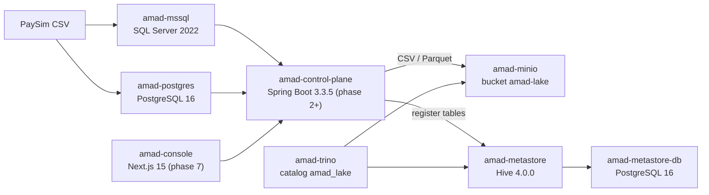

# FinLakeAmad — Architecture



## Phase 0 decisions
| Decision | Reason |
|---|---|
| Custom metastore image (`infra/hive-metastore/Dockerfile`) downloading the PostgreSQL JDBC, `hadoop-aws` and AWS SDK jars at build time | `apache/hive:4.0.0` ships none of them; no binaries committed |
| `${env.VAR}` in `metastore-site.xml`, `${ENV:VAR}` in Trino catalog | Keeps every credential in `.env` |
| `alpine/minio:RELEASE.2025-10-15T17-29-55Z` | Official `minio/minio` release tags are no longer pullable |
| Bucket bootstrap with `amazon/aws-cli:2.17.0` | MinIO image has no `mc`; S3 API is enough |
| Trino native S3 filesystem (`fs.native-s3.enabled`) | Legacy `hive.s3.*` properties are deprecated in Trino 452 |
| All images pinned, all services healthchecked, named volumes, single bridge network `finlake-amad-net` | Reproducibility (cahier §9) |

## Storage layout (cahier §8)
```
s3://amad-lake/
  raw/paysim/transactions/ingest_date=YYYY-MM-DD/run_id=<uuid>/...
  staging/<run_id>/...
  curated/paysim/transactions/event_date=YYYY-MM-DD/...
  manifests/paysim/transactions/<run_id>.json
```
