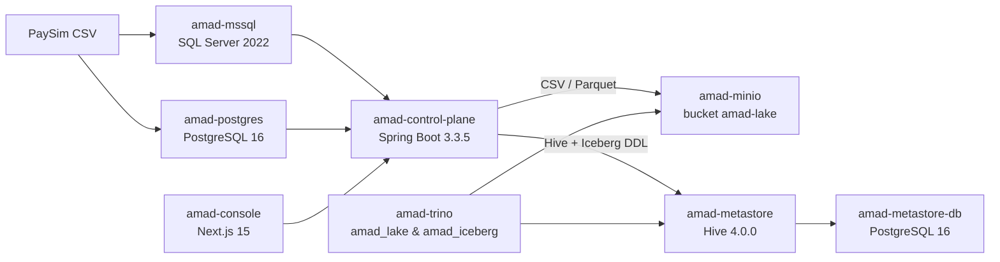

# FinLakeAmad — Architecture



## Phase 0 decisions
| Decision | Reason |
|---|---|
| Custom metastore image (`infra/hive-metastore/Dockerfile`) downloading the PostgreSQL JDBC, `hadoop-aws` and AWS SDK jars at build time | `apache/hive:4.0.0` ships none of them; no binaries committed |
| `${env.VAR}` in `metastore-site.xml`, `${ENV:VAR}` in Trino catalog | Keeps every credential in `.env` |
| `alpine/minio:RELEASE.2025-10-15T17-29-55Z` | Official `minio/minio` release tags are no longer pullable |
| Bucket bootstrap with `amazon/aws-cli:2.17.0` | MinIO image has no `mc`; S3 API is enough |
| Trino native S3 filesystem (`fs.native-s3.enabled`) | Legacy `hive.s3.*` properties are deprecated in Trino 452 |
| All images pinned, all services healthchecked, named volumes, single bridge network `finlake-amad-net` | Reproducibility (cahier §9) |

## Storage layout (cahier §8 & §13)
```
s3://amad-lake/
  raw/paysim/amad_transactions/ingest_date=YYYY-MM-DD/run_id=<uuid>/...
  staging/<run_id>/...   (always cleaned up in finally block)
  curated/paysim/amad_transactions/event_date=YYYY-MM-DD/...
  iceberg/amad_transactions/...   (Iceberg metadata + Parquet data files)
  manifests/paysim/amad_transactions/<run_id>.json
```

## Phase P7 (Bonus) — Iceberg & Incremental Watermark Design
- **Catalogues Trino** :
  - `amad_lake` (`connector.name=hive`) : tables externes Parquet partitionnées par `event_date` (sans garanties ACID).
  - `amad_iceberg` (`connector.name=iceberg`, `iceberg.catalog.type=hive_metastore`) : tables Apache Iceberg sous `s3a://amad-lake/iceberg/` avec snapshots atomiques, évolution de schéma (`ALTER TABLE ... ADD COLUMN IF NOT EXISTS`) et Time Travel (`FOR VERSION AS OF` / `FOR TIMESTAMP AS OF`).
- **Ingestion incrémentale & limites PaySim** :
  - `KeysetBatchReader` supporte le watermark sur `ingest_row_id` (clé monotone stricte `1..6 362 620`) ou `step` (seau horaire synthétique `1..743`, non unique).
  - PaySim étant un dataset synthétique statique sans colonne `updated_at` ni journal CDC (pas de mises à jour ni de suppressions), le mode `step` combine `WHERE step > ? AND ingest_row_id > ? ORDER BY ingest_row_id ASC` afin de conserver une pagination O(1) à mémoire bornée sans sauter ni dupliquer de lignes.
- **Relance idempotente** :
  - `AmadIngestionService` garantit le nettoyage de `staging/<run_id>/` dans un bloc `finally` (succès, annulation ou erreur) et purge les cibles non-`raw` avant promotion lorsque `idempotent=true` en chargement complet.
